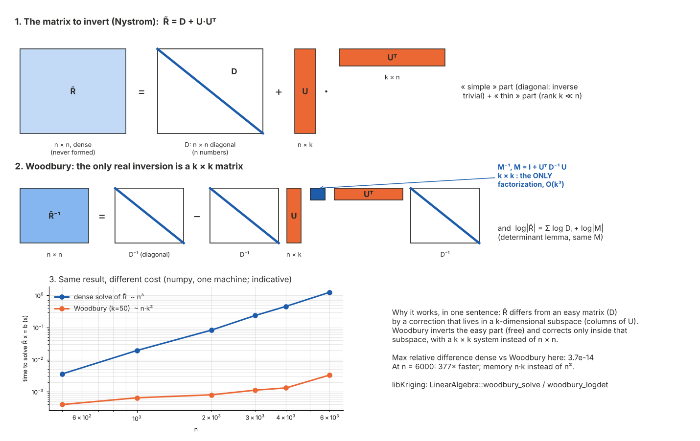

# Nystrom approximation (`method="nystrom(k)"`)

## Idea

Exact Gaussian process likelihood evaluation costs O(n³) (Cholesky
factorization of the n×n covariance matrix R), which becomes impractical
somewhere in the n = 10³–10⁴ range. The Nystrom approximation replaces R
with a global rank-k factorization built from a fixed subset of k
"landmark" points:

  R ≈ R_ns · R_ss⁻¹ · R_ns.t()

where S is the set of k landmarks and R_ns / R_ss are the n×k / k×k
covariance blocks between all points / among the landmarks. This turns
the O(n³) exact factorization into O(n·k²) work per likelihood
evaluation via the Woodbury identity, without ever materializing the
n×n matrix R.

libKriging exposes it as a fit method of the log-likelihood objective,
`method="nystrom"` (default k = 50 landmarks) or `method="nystrom(k)"`
for an explicit rank k (with `objective="LL"`, the default), in C++ and
every binding. `method()` then returns `"nystrom(k)"`, `objective()`
`"LL"`. `objective="LLNystrom(k)"` is a deprecated alias of
`objective="LL", method="nystrom(k)"` (deprecation warning).

```r
k <- Kriging(y, X, "matern5_2", method = "nystrom(50)")   # or "nystrom"
```

Complementary to `method="vecchia(m)"`: Vecchia is a *local* approximation (each
point conditions on a handful of nearest neighbors) whereas Nystrom is a
*global* low-rank approximation (every point shares the same k landmarks).
Nystrom tends to degrade more gracefully with input dimension than
Vecchia (no reliance on spatial nearest-neighbor structure), at the cost
of needing k large enough to capture the process' effective rank —
which grows with how short the correlation range is relative to the
domain.

## Illustration


How to read it:

- (a) Nystrom never uses the correlation between two data points
  directly: R̃(x_i, x_j) = r_iᵀ R_ss⁻¹ r_j, where r_i is the correlation
  of x_i with the k landmarks (stars; line width ∝ correlation). Two
  close points are seen as correlated only if some landmark is close to
  both. Here x_i and its nearest neighbor x_j have R = 0.89 but
  R̃ = 0.44: their closest landmark is too far (correlation ≈ 0.5).
- (b) R̃ (rank k, plus a diagonal reset to 1) in the same ordering as
  the exact R: the cluster blocks are still there but faded. Only the
  n×k block R_ns and the k×k block R_ss are computed; R̃ itself is never
  formed (Woodbury identity, O(n·k²)).
- (c) The error is on close pairs (near-diagonal blocks), not on distant
  pairs, whose correlation is ≈ 0 in both R and R̃.

The landmarks are chosen once, by greedy pivoted Cholesky on a reference
kernel whose range is the data extent: each new landmark is the point
worst explained by the previous ones, which favors the domain's border
and corners first. Shorter ranges θ (relative to the landmark spacing)
make the error grow: k must grow with the number of correlation lengths
that fit in the domain.

(a) input space: which points a given x_i is coupled to; (b) what is factorized or kept of the n×n correlation matrix R; (c) |R̃ − R|, the error of the covariance the fit implicitly assumes (same scale and ordering for every method — compare with the other methods in [Scalability.md](Scalability.md#visual-comparison)). Toy sizes (n = 160), not the defaults; regenerate with `python3 docs/math/scalability_figures.py`.

## Mathematical description

- **Landmarks**: a fixed set S of k points, chosen ONCE (before
  optimization starts, from a theta-neutral reference kernel scaled to
  the data's own extent) via `LinearAlgebra::nystromFactor`'s greedy
  pivoted-Cholesky selection, and held fixed across every θ evaluation
  during the fit. Re-selecting landmarks at each θ would make the
  objective (and its gradient) discontinuous in θ, since the pivot
  choice itself depends on the current covariance values.
- **Low-rank factor**: once S is fixed, R_ss (k×k) and R_ns (n×k) are
  ordinary, smooth functions of θ. With L_ss = chol(R_ss),
  U := R_ns · L_ss⁻ᵀ satisfies U·Uᵀ = R_ns · R_ss⁻¹ · R_ns.t() exactly.
- **Woodbury identity**: R⁻¹ and log|R| are obtained from U and the
  residual diagonal D = max(1 − diag(U·Uᵀ), num_nugget) (which restores
  a unit diagonal, the floor keeping D⁻¹ finite for points at or next to
  a landmark) through `LinearAlgebra::woodbury_solve` /
  `woodbury_logdet`, both O(n·k²) — the dense n×n matrix R is never
  formed. See the illustration below.
- **Profiling**: matches the exact `"LL"` objective — σ² has a closed
  form and β is profiled by generalized least squares, using the same
  GLS formulas as the exact objective, just solved via Woodbury instead
  of a dense Cholesky.
- **Gradient**: analytic (envelope theorem — β̂/σ̂² don't contribute
  their own θ-dependence since ∂ll/∂β = ∂ll/∂σ² = 0 at the profiled
  values), same principle as the Vecchia gradient. An earlier version
  used a finite-difference gradient instead; it worked but was more
  sensitive to the likelihood surface's local curvature near
  small-θ / near-singular-R regions than the analytic form is.
- **Exactness at k = n**: with k equal to the sample size, the
  factorization is exact and `method="nystrom(n)"` reproduces the exact
  concentrated log-likelihood at any θ (used as a correctness check in
  `KrigingNystromTest.cpp`).
- **Prediction**: the method is always explicit. A Nystrom fit keeps
  no exact factorization, so `predict` / `simulate` with method
  `"exact"` (the default) raise an error (`logLikelihood()` recomputes the
  exact log-likelihood at the fitted θ, in O(n³));
  `predict(…, method="nystrom")` (or exactly the fitted `"nystrom(k)"`,
  e.g. the string returned by `method()`; another k raises)
  (C++ `predictNystrom`) reuses the committed rank-k factors (U, D) via
  the Woodbury identity — O(n k q) instead of O(n² q) for q points
  (mean and stdev only: `return_cov` / `return_deriv` raise), and
  `simulate(…, method="nystrom")` (C++ `simulateNystrom`) draws joint
  trajectories through the same low-rank machinery (no `will_update`).
  Method `"vecchia"` (local predictor, needs only θ / β / σ²) is also
  available, and `logLikelihood(method="nystrom")` gives the fitted
  Nystrom objective. The exact model at the Nystrom θ* is a separate
  exact fit with `optim="none"` and the fitted θ (as for Vecchia, see
  [Vecchia.md](Vecchia.md)).
- **Update/save**: a Nystrom fit never holds an exact n×n
  factorization (as a Vecchia fit). `update` goes through a dedicated
  incremental path (`update_nystrom`, extends the landmarks-fixed
  factorization without a full O(n³) refit) and `save`/`load` serialize
  the committed rank-k factors (U, D) directly (and the method); `update_simulate`
  raises a clear error (no such path exists yet, see Current
  limitations).

### Woodbury identity, illustrated



1. The approximated matrix is R̃ = D + U·Uᵀ: an *easy* part (D,
   diagonal, inverted by n divisions) plus a *thin* part (U is n×k, so
   U·Uᵀ has rank k ≪ n and only acts in a k-dimensional subspace).
2. Woodbury inverts the easy part and corrects only inside that
   subspace:

   R̃⁻¹ = D⁻¹ − D⁻¹U · M⁻¹ · UᵀD⁻¹,   M = I_k + UᵀD⁻¹U  (k×k)

   log|R̃| = Σ log Dᵢ + log|M|   (matrix determinant lemma, same M)

   The only factorization is that of the k×k matrix M (O(k³)); the rest
   is products with U (O(n·k²)). Memory: U and D, n·(k+1) numbers
   instead of n².
3. Same solution as a dense solve (relative difference ~1e-14 in the
   figure), at a fraction of the cost; the timings are indicative (numpy,
   one machine) and the gain shrinks as k approaches n.

Woodbury itself is exact: the approximation error of Nystrom comes
entirely from replacing R by D + U·Uᵀ (see the illustration at the top
of this page), not from this identity. Regenerate the figure with
`python3 docs/math/scalability_figures.py`.

## Usage

```r
library(rlibkriging)

set.seed(1)
n <- 2000
X <- matrix(runif(2 * n), ncol = 2)
y <- sin(3 * X[, 1]) * cos(3 * X[, 2]) + rnorm(n, sd = 0.05)

# Exact objective would cost O(n^3) ~ 8e9 ops; Nystrom costs O(n*k^2).
k <- Kriging(y, X, "matern5_2", method = "nystrom(50)")

Xnew <- matrix(runif(2 * 10), ncol = 2)
pred <- predict(k, Xnew, return_stdev = TRUE, method = "nystrom")  # explicit: no exact factorization
```

## Current limitations

- `objective="LL"` and `NoiseModel::None` only (no LOO / LMP version,
  no nugget/noise channel).
- Landmarks are not serialized (rebuilt on refit).
- Rank k is a fixed hyperparameter chosen by the caller; there is no
  automatic rank selection based on a target approximation accuracy.
- **Free MLE fits (`optim="BFGS"` with no starting `theta`) can drift
  toward a large-θ degenerate optimum on smooth/near-deterministic test
  functions**, giving a poor predictor despite a high objective value.
  This is not specific to the Nystrom method: it is the standard GP-MLE
  degeneracy that affects the exact `"LL"` objective just as much on
  such data (verified directly — both the exact and Nystrom
  concentrated log-likelihoods increase together with θ once σ² is
  correctly profiled at each θ, rather than held fixed). The practical
  mitigation is the same one used throughout this codebase's own test
  suites: seed or fix `theta` at a domain-informed value rather than
  trusting a single free `optim="BFGS"` run on deterministic data.

## See also

[llnystrom_vs_cholesky.ipynb](llnystrom_vs_cholesky.ipynb) for a worked,
executed notebook: the math above illustrated on a running example, with
rank-$k$ convergence/accuracy/timing plots and references.
[Scalability.md](Scalability.md) for how this compares to `method="vecchia(m)"`
and `NestedKriging`, and how to pick between them.

## References

- Williams, C. K. I., & Seeger, M. (2001). *Using the Nystrom method to
  speed up kernel machines*. Advances in Neural Information Processing
  Systems, 13, 682–688.
- Drineas, P., & Mahoney, M. W. (2005). *On the Nystrom method for
  approximating a Gram matrix for improved kernel-based learning*.
  Journal of Machine Learning Research, 6, 2153–2175.
