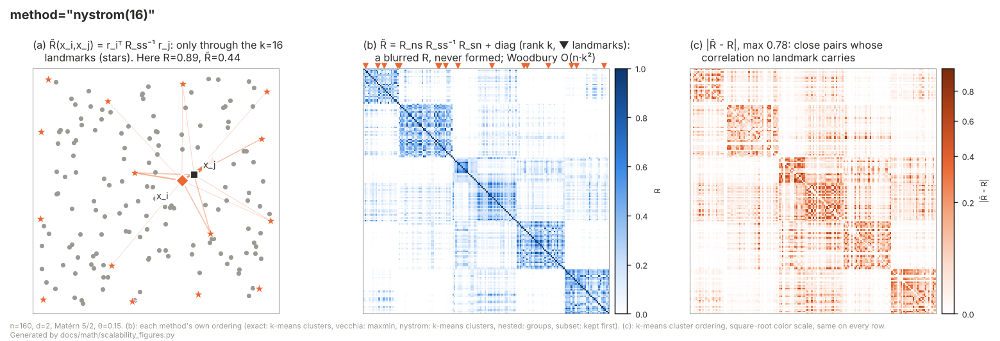

# Nystrom approximation (`method="nystrom(k)"`)

## Idea

Exact Gaussian process likelihood evaluation costs O(n³) (Cholesky
factorization of the n×n covariance matrix R), which becomes impractical
somewhere in the n = 10³–10⁴ range. The Nystrom approximation replaces R
with a global rank-k factorization built from a fixed subset of k
"landmark" points:

  R ≈ R_ns · R_ss⁻¹ · R_ns.t()

where S is the set of k landmarks and R_ns / R_ss are the n×k / k×k
covariance blocks between all points / among the landmarks. This turns
the O(n³) exact factorization into O(n·k²) work per likelihood
evaluation, without ever materializing the n×n matrix R.

libKriging exposes it as a fit method of the log-likelihood objective,
`method="nystrom"` (default k = 50 landmarks) or `method="nystrom(k)"`
for an explicit rank k (with `objective="LL"`, the default), in C++ and
every binding. `method()` then returns `"nystrom(k)"`, `objective()`
`"LL"`. `objective="LLNystrom(k)"` is a deprecated alias of
`objective="LL", method="nystrom(k)"` (deprecation warning).

```r
k <- Kriging(y, X, "matern5_2", method = "nystrom(50)")   # or "nystrom"
```

Complementary to `method="vecchia(m)"`: Vecchia is a *local* approximation (each
point conditions on a handful of nearest neighbors) whereas Nystrom is a
*global* low-rank approximation (every point shares the same k landmarks).
Nystrom tends to degrade more gracefully with input dimension than
Vecchia (no reliance on spatial nearest-neighbor structure), at the cost
of needing k large enough to capture the process' effective rank —
which grows with how short the correlation range is relative to the
domain.

## Illustration



Every point is coupled to the same k landmarks (greedy pivoted Cholesky picks spread-out points, often on the border). R̃ is rank k plus a diagonal correction: long-range structure is kept, short-range correlation between points far from any landmark is lost — the error sits near the diagonal.

(a) input space: which points a given x_i is coupled to; (b) what is factorized or kept of the n×n correlation matrix R; (c) |R̃ − R|, the error of the covariance the fit implicitly assumes (same scale and ordering for every method — compare with the other methods in [Scalability.md](Scalability.md#visual-comparison)). Toy sizes (n = 160), not the defaults; regenerate with `python3 docs/math/scalability_figures.py`.

## Mathematical description

- **Landmarks**: a fixed set S of k points, chosen ONCE (before
  optimization starts, from a theta-neutral reference kernel scaled to
  the data's own extent) via `LinearAlgebra::nystromFactor`'s greedy
  pivoted-Cholesky selection, and held fixed across every θ evaluation
  during the fit. Re-selecting landmarks at each θ would make the
  objective (and its gradient) discontinuous in θ, since the pivot
  choice itself depends on the current covariance values.
- **Low-rank factor**: once S is fixed, R_ss (k×k) and R_ns (n×k) are
  ordinary, smooth functions of θ. With L_ss = chol(R_ss),
  U := R_ns · L_ss⁻ᵀ satisfies U·Uᵀ = R_ns · R_ss⁻¹ · R_ns.t() exactly.
- **Low rank + diagonal**: R̃ = U·Uᵀ + diag(D), with the residual
  diagonal D = 1 − diag(U·Uᵀ) floored at `num_nugget` (1e-10), which
  keeps R̃ SPD. At a landmark row D is exactly `num_nugget` (see
  [Numerical factorization](#numerical-factorization)). R̃⁻¹ and log|R̃|
  are O(n·k²) — the dense n×n matrix R is never formed.
- **Profiling**: matches the exact `"LL"` objective — σ² has a closed
  form and β is profiled by generalized least squares, using the same
  GLS formulas as the exact objective, just solved through the
  factorization below instead of a dense Cholesky.
- **Gradient**: analytic (envelope theorem — β̂/σ̂² don't contribute
  their own θ-dependence since ∂ll/∂β = ∂ll/∂σ² = 0 at the profiled
  values), same principle as the Vecchia gradient. An earlier version
  used a finite-difference gradient instead; it worked but was more
  sensitive to the likelihood surface's local curvature near
  small-θ / near-singular-R regions than the analytic form is.
- **Exactness at k = n**: with k equal to the sample size, the
  factorization is exact and `method="nystrom(n)"` reproduces the exact
  concentrated log-likelihood at any θ (used as a correctness check in
  `KrigingNystromTest.cpp`).
- **Prediction**: the method is always explicit. A Nystrom fit keeps
  no exact factorization, so `predict` / `simulate` with method
  `"exact"` (the default) raise an error (`logLikelihood()` recomputes the
  exact log-likelihood at the fitted θ, in O(n³));
  `predict(…, method="nystrom")` (or exactly the fitted `"nystrom(k)"`,
  e.g. the string returned by `method()`; another k raises)
  (C++ `predictNystrom`) reuses the committed rank-k factors (U, D)
  through the same factorization — O(n k q) instead of O(n² q) for q points
  (mean and stdev only: `return_cov` / `return_deriv` raise), and
  `simulate(…, method="nystrom")` (C++ `simulateNystrom`) draws joint
  trajectories through the same low-rank machinery (no `will_update`).
  Method `"vecchia"` (local predictor, needs only θ / β / σ²) is also
  available, and `logLikelihood(method="nystrom")` gives the fitted
  Nystrom objective. The exact model at the Nystrom θ* is a separate
  exact fit with `optim="none"` and the fitted θ (as for Vecchia, see
  [Vecchia.md](Vecchia.md)).
- **Update/save**: a Nystrom fit never holds an exact n×n
  factorization (as a Vecchia fit). `update` goes through a dedicated
  incremental path (`update_nystrom`, extends the landmarks-fixed
  factorization without a full O(n³) refit) and `save`/`load` serialize
  the committed rank-k factors (U, D) and the landmarks directly (and the method); `update_simulate`
  raises a clear error (no such path exists yet, see Current
  limitations).

## Numerical factorization

R̃ = U·Uᵀ + diag(D) is solved and log-determined by a block Cholesky
factorization with the k landmark rows S first (N: the other n − k rows):

- R̃_SS = U_S·U_Sᵀ + diag(D_S) = L_A·L_Aᵀ, from a QR factorization of
  [U_Sᵀ; diag(D_S)^½] (the Gram matrix U_S·U_Sᵀ is never formed);
- R̃_NS = U_N·U_Sᵀ = L_NS·L_Aᵀ;
- the Schur complement R̃_NN − L_NS·L_NSᵀ = diag(D_N) + U_N·H·U_Nᵀ, with
  H = (I + U_Sᵀ·diag(D_S)⁻¹·U_S)⁻¹ also from a QR factorization, is
  "rank k + diagonal" with a diagonal D_N away from `num_nugget` (but for
  rows nearly duplicating a landmark), and is solved by the Woodbury
  identity.

Everything stays O(n·k²). With k = n every row is a landmark, and
R̃ = L_A·L_Aᵀ reproduces the exact Cholesky factorization (log-likelihood
equal to the exact one to ~1e-12 relative).

Why not the Woodbury identity on the whole of R̃, as before #410: at a
landmark row i, 1 − (U·Uᵀ)_ii = ε − ε²[(R_ss + εI)⁻¹]_ii ∈ [0, ε]
(ε = `num_nugget`), so D_i = ε. Woodbury weights these rows by 1/ε = 1e10
and forms I + Uᵀ·D⁻¹·U, a Gram matrix squaring their conditioning: the
result then depended on rounding, i.e. on the CPU and BLAS kernel. With
k = n the log-likelihood was off the exact one by 1e-7 to 4e-6 relative,
and with an ill-conditioned R_ss (smooth Gaussian kernel, k = 10) a 1-ulp
perturbation of X moved the predicted mean by ~60% of sd(y). The block
factorization brings these to ~1e-12 and ~1e-6 respectively
(`KrigingNystromTest.cpp`, "#410"). For the same reason D_i is set to ε
at the landmark rows instead of computed as 1 − (≈1), whose rounding
decided whether the floor applied.

## Noise models (`noise="nugget"` / heterogeneous `noise`)

`method="nystrom(k)"` also works with the two noise models of
[Noise.md](Noise.md). Write C̃ = U·Uᵀ + diag(D) for the Nystrom
correlation above (U = R_ns · L_ss⁻ᵀ, D = 1 − diag(U·Uᵀ), jittered), the
approximation of ρ(θ). The noise model only changes the diagonal (and
scale) of the factorized matrix, which stays "rank k + diagonal":

- **nugget** (γ = [θ, α], α = σ²/(σ²+τ²)):
  R̂ = α·C̃ + (1 − α)·I = (√α·U)(√α·U)ᵀ + diag(α·D + 1 − α)
- **heterogeneous** (γ = [θ, σ²], known noise_i):
  R̂ = C̃ + diag(noise)/σ² = U·Uᵀ + diag(D + noise/σ²)

The log-likelihood has the exact one's form,
ll(γ) = −½ ( n·log(2π·v) + log|R̂| + e'R̂⁻¹e / v ), e = y − F·β̂ (β̂ by GLS
through R̂⁻¹), with the same profiling of the variance scale v
(Cov(y) = v·R̂) as the exact noise-model objectives:

| model | v | concentrated? |
|---|---|---|
| nugget, σ² and τ² estimated | e'R̂⁻¹e / n (= σ² + τ²) | yes |
| nugget, τ² fixed | τ² / (1 − α) | no |
| nugget, σ² fixed | σ² / α | no |
| nugget, both fixed | σ² + τ² (α forced to σ²/(σ²+τ²)) | – |
| heterogeneous | σ² (optimized, γ_{d+1}) | no |

Gradient (analytic): for any parameter p of R̂ (and of v),
∂ll/∂p = −½ ( n·v'/v + tr(R̂⁻¹ ∂R̂/∂p) − x'(∂R̂/∂p)x / v − e'R̂⁻¹e·v'/v² ),
x = R̂⁻¹e, v' = 0 when v is concentrated (envelope theorem), with

- ∂R̂/∂θ_k = c·∂C̃/∂θ_k, c = α (nugget) or 1 (heterogeneous): the same
  O(n·k²) trace identities as the noise-free gradient, R̂⁻¹ now
  being that of the noisy R̂;
- ∂R̂/∂α = C̃ − I = U·Uᵀ + diag(D − 1): x'(∂R̂/∂α)x = ‖Uᵀx‖² + Σ(D_i − 1)x_i²,
  tr(R̂⁻¹ ∂R̂/∂α) = tr(Uᵀ R̂⁻¹ U) + Σ(D_i − 1)(R̂⁻¹)_ii;
- ∂R̂/∂σ² = −diag(noise)/σ⁴ (v' = 1): only diag(R̂⁻¹) and x are needed.

All of it is O(n·k²) per evaluation, and at k = n (full rank) it
reproduces the exact noise-model log-likelihood and gradient (tested in
`KrigingNystromTest.cpp`). The optimizer uses the same γ
reparametrizations and bounds as the exact noise-model fits (α in
[10⁻³, 1]; σ² bounds from the variogram, computed on an evenly spaced
subsample of at most 500 points instead of all O(n²) pairs).

The fitted σ², τ² (α) follow the exact conventions (σ̂² = α·v̂,
τ̂² = (1 − α)·v̂ when both are estimated), and the committed (U, D) are
the factors of R̂ (so the noise is part of the saved factors).
Prediction and simulation follow the exact semantics:

- **predict, nugget**: cross-correlations α·C(x_i, x) (1 where x coincides
  with an observation), mean F·β̂ + rᵀR̂⁻¹e, variance
  (σ² + τ²)·(1 − rᵀR̂⁻¹r) (β treated as known, as in the noise-free
  Nystrom predictor: no trend-estimation term);
- **predict, heterogeneous**: cross-correlations C(x_i, x), variance
  σ²·(1 − rᵀR̂⁻¹r) (noise-free latent process);
- **simulate**: the latent process (exact default: `with_nugget=false`,
  no `with_noise`), i.e. covariance σ²·(C_nn − α·rᵀR̂⁻¹r) for a nugget.
- **update**: nugget fits use the landmarks-fixed `update_nystrom` path
  (warm-restart over (θ, α) when `refit=true`); a heterogeneous fit needs
  the noise of the new points, `update(y_u, noise_u, X_u)`, which refits
  on the joined data (as the exact heterogeneous update).

## Usage

```r
library(rlibkriging)

set.seed(1)
n <- 2000
X <- matrix(runif(2 * n), ncol = 2)
y <- sin(3 * X[, 1]) * cos(3 * X[, 2]) + rnorm(n, sd = 0.05)

# Exact objective would cost O(n^3) ~ 8e9 ops; Nystrom costs O(n*k^2).
k <- Kriging(y, X, "matern5_2", method = "nystrom(50)")

Xnew <- matrix(runif(2 * 10), ncol = 2)
pred <- predict(k, Xnew, return_stdev = TRUE, method = "nystrom")  # explicit: no exact factorization
```

## Current limitations

- Noise models are supported with `objective="LL"` (see above), but the
  approximate simulator has no `with_nugget=true` / `with_noise` variant
  (the `simulate(…, with_nugget | with_noise, will_update,
  method="nystrom")` overloads raise for them), and `update_simulate` is
  unavailable as for the noise-free Nystrom fit.
- `objective="LOO"` and `"LMP"` have Nystrom versions for
  `NoiseModel::None` (LOO under the low-rank joint law, same
  factorization; see [LOO.md](LOO.md) and [LMP.md](LMP.md)): they
  inherit the smoothing bias of R̂ for small k; with a noise model they raise.
- Landmarks are serialized with the fit, but only re-picked by a full
  `fit` (an `update` keeps them).
- Rank k is a fixed hyperparameter chosen by the caller; there is no
  automatic rank selection based on a target approximation accuracy.
- **Free MLE fits (`optim="BFGS"` with no starting `theta`) can drift
  toward a large-θ degenerate optimum on smooth/near-deterministic test
  functions**, giving a poor predictor despite a high objective value.
  This is not specific to the Nystrom method: it is the standard GP-MLE
  degeneracy that affects the exact `"LL"` objective just as much on
  such data (verified directly — both the exact and Nystrom
  concentrated log-likelihoods increase together with θ once σ² is
  correctly profiled at each θ, rather than held fixed). The practical
  mitigation is the same one used throughout this codebase's own test
  suites: seed or fix `theta` at a domain-informed value rather than
  trusting a single free `optim="BFGS"` run on deterministic data.

## See also

[llnystrom_vs_cholesky.ipynb](llnystrom_vs_cholesky.ipynb) for a worked,
executed notebook: the math above illustrated on a running example, with
rank-$k$ convergence/accuracy/timing plots and references.
[Scalability.md](Scalability.md) for how this compares to `method="vecchia(m)"`
and `NestedKriging`, and how to pick between them.

## References

- Williams, C. K. I., & Seeger, M. (2001). *Using the Nystrom method to
  speed up kernel machines*. Advances in Neural Information Processing
  Systems, 13, 682–688.
- Drineas, P., & Mahoney, M. W. (2005). *On the Nystrom method for
  approximating a Gram matrix for improved kernel-based learning*.
  Journal of Machine Learning Research, 6, 2153–2175.
