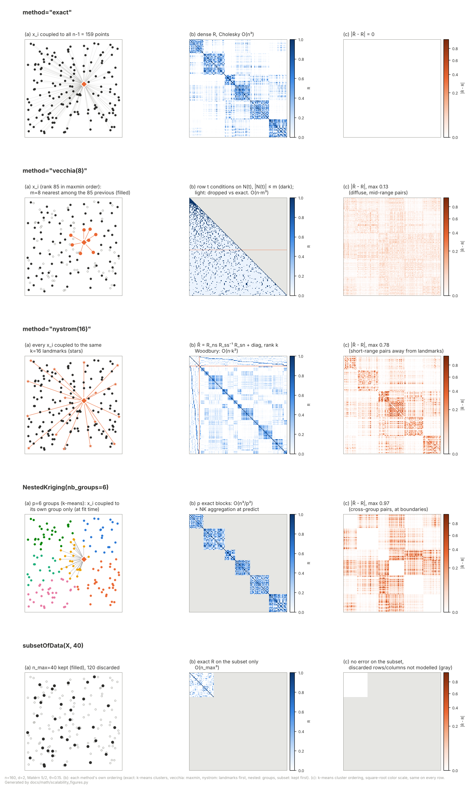

# Scaling past exact Kriging — method inventory

## Idea

Exact Kriging costs O(n³) to fit (Cholesky factorization of the n×n
covariance matrix) and O(n²) per `predict` call (reusing that factor),
which becomes impractical somewhere in the n = 10³–10⁴ range depending
on available memory and time budget. There is no single fix — fit cost,
predict cost, and memory are three separate axes, and libKriging
addresses each with a different, independently-usable method rather
than one do-everything mechanism. This page is the inventory; each
method has its own page with the full derivation.

| Method | Axis | Cost | Approximates | Dimension sensitivity | Doc |
|---|---|---|---|---|---|
| `method="vecchia(m)"` | fit method (`objective="LL"`) | O(n·m³)/eval | *local* conditioning (m neighbors) | degrades for d ≳ 5 (nearest neighbors less informative) | [Vecchia.md](Vecchia.md) |
| `method="nystrom(k)"` | fit method (`objective="LL"`) | O(n·k²)/eval | *global* low-rank covariance (k landmarks) | dimension-robust | [Nystrom.md](Nystrom.md) |
| `NestedKriging` | fit + predict, whole model | O(n³/p²) fit, O(q·n²/p) or O(q·n²) predict | divide-and-conquer (p groups) + aggregation | dimension-robust (submodels are exact Kriging) | [Nested.md](Nested.md) |
| `subsetOfData` | pre-fit data reduction | O(n_max) k-means pass, then ordinary O(n_max³) fit | *nothing* — exact fit, just on fewer points | none (discards points outright rather than approximating structure) | [SubsetOfData.md](SubsetOfData.md) |
| OpenMP | fit + predict, cross-cutting | same asymptotic cost, smaller constant | *nothing* — exact, just parallel | none | — (build-time; no dedicated objective/method, always on when available) |

All of these (Vecchia, Nystrom, NestedKriging, subsetOfData) are usable
independently and, where noted below, combinable — none of them require
opting out of the others.

For `Kriging`, the method is explicit at every step, never inferred from
the fit: `fit` takes `method="exact"` (default), `"vecchia(m)"` or
`"nystrom(k)"` (with `objective="LL"`), and `predict` / `simulate` /
`logLikelihood` take `method="exact"` (default, needs an exact fit),
`"vecchia"` / `"vecchia(m)"` (local predictor / sequential simulator,
usable after any fit, O(q·m³)) or `"nystrom"` (after a Nystrom fit). A
Vecchia or Nystrom fit holds no exact factorization, so `"exact"` raises
there; the exact model at the approximate estimate is a separate exact
fit with `optim="none"` and the fitted θ. Step × method table:
[bindings/README.md](../../bindings/README.md).

## Visual comparison

One row per method, on the same 2D design (n = 160, Matérn 5/2, θ = 0.15;
toy sizes m = 8, k = 16, p = 6, n_max = 40 so that the structures stay
readable — not the defaults). Columns: (a) which points a given x_i is
coupled to; (b) what is factorized or kept of R, in the method's own
ordering; (c) |R̃ − R| for the covariance the fit implicitly assumes,
with the same color scale and spatial ordering on every row.

Reading (c) across rows: Vecchia keeps the short range and spreads a
small error over mid-range pairs; Nystrom keeps the long range and loses
short-range correlation away from its landmarks; NestedKriging drops
exactly the cross-group terms (re-coupled by the NK aggregation at
predict time only); subsetOfData has no error on what it keeps and
ignores the rest. These patterns depend on θ relative to the point
spacing: on this design, mean |R̃ − R| goes from 0.019 to 0.013 for
Nystrom(16) and from 0.002 to 0.017 for Vecchia(8) when θ goes from 0.07
to 0.3 — a shorter range needs a larger k, a longer range makes the
terms Vecchia drops matter more.

Per-method figures are in each method's page; all are generated by
[scalability_figures.py](scalability_figures.py) (numpy + matplotlib,
re-implements the selection rules of `src/lib/Kriging.cpp` without
needing a libKriging build).

## Which one, when

1. **Is the *fit* itself (not just prediction) too slow, and you're
   willing to accept a genuinely different objective — not just a
   cheaper way to evaluate the same one?**
   - **Low-to-moderate dimension (d ≲ 5), spatially local structure**
     → `method="vecchia(m)"`. Local conditioning on m nearest
     neighbors; the approximation degrades as nearest neighbors become
     less informative in higher dimension.
   - **Higher dimension, or no reliable local/spatial structure**
     → `method="nystrom(k)"`. Global low-rank approximation,
     dimension-robust the same way `NestedKriging`'s `NK` aggregation
     is, but as a single model rather than a partition.
   - **n large enough (~10⁴–10⁶) that even Vecchia/Nystrom struggle, and
     the design can be partitioned / prediction can be parallelized**
     → `NestedKriging`. Splits `(X, y)` into p groups, fits exact
     submodels per group, aggregates predictions (`NK` by default —
     converges to the exact/PoE-family predictor as group size grows;
     see [Nested.md](Nested.md) §3 for the aggregation choice).
   - **Willing to lose information rather than approximate it**:
     `subsetOfData(X, n_max)` picks `n_max` representative rows
     (k-means, snapped to real points) and hands them to an ordinary
     exact fit — no new objective, no iterative linear algebra, just
     fewer points. The cheapest option by far, at the cost of
     discarding `n - n_max` observations outright rather than using all
     of them more cheaply the way every other method here does.

2. **Regardless of which of the above you use**: OpenMP parallelizes
   independent work (multi-start `optim`, multi-trajectory `simulate`,
   multi-point `predict`) transparently when built with it — no API
   change, always worth having on for large designs.

Don't reach for any of these by default: for the common case (n in the
hundreds to low thousands), plain exact `Kriging` is both simpler and,
for `NestedKriging`'s `NK` aggregation specifically, a *fallback
target* it converges to as group size grows.

## Combining methods

- **`NestedKriging` + Vecchia / Nystrom**: `NestedKriging`'s common-prior
  fit can estimate the shared (θ, σ², β) via one global Vecchia or
  Nystrom fit (`method="vecchia(m)"` / `"nystrom(k)"`) instead of
  per-group fits — see [Nested.md](Nested.md)'s "Common prior" section.
- **`subsetOfData` before any of the above**: since it's a plain
  pre-fit row selection, not a fit objective, it composes with every
  other method here — reduce `(X, y)` first, then fit with
  Vecchia / Nystrom / `NestedKriging` / exact `"LL"` on the reduced
  design if it's still large enough to warrant one of them.
- **Vecchia/Nystrom + `NoiseModel`**: neither supports a nugget/noise
  channel yet (`NoiseModel::None` only) — see each method's own
  "Current limitations" section.

## Not implemented (deferred)

Evaluated and explicitly out of scope for now (see the project's own
scalability roadmap analysis): GPU acceleration (a Bandicoot port would
be the lowest-effort path, since it mirrors Armadillo's API, but
untested on this project's target platforms), and structured/inducing-
point variational methods (KISS-GP/SKI, SVGP) — these would need a
substantially different inference engine (approximate ELBO, automatic
differentiation through arbitrary kernel compositions) rather than an
incremental addition to the current exact-linear-algebra core. See
[libKriging_vs_GPyTorch.ipynb](../comparisons/libKriging_vs_GPyTorch.ipynb)
for a direct comparison against a library that does implement these
(GPyTorch's BBMM/CG + GPU + variational stack).

## References

See each method's own page ([Vecchia.md](Vecchia.md),
[Nystrom.md](Nystrom.md), [Nested.md](Nested.md),
[SubsetOfData.md](SubsetOfData.md)) for its specific references.
