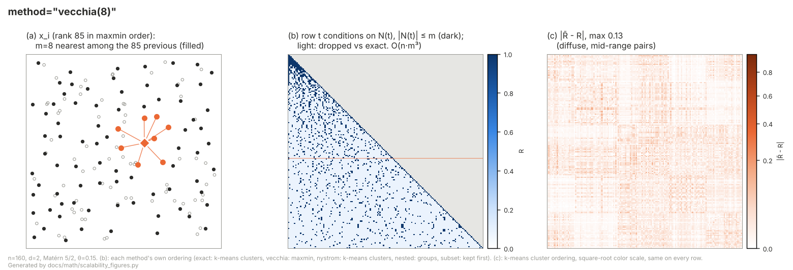

# Vecchia approximation (`method="vecchia(m)"`)

## Idea

Exact Gaussian process likelihood evaluation costs O(n³) (Cholesky
factorization of the n×n covariance matrix), which becomes impractical
somewhere in the n = 10³–10⁴ range. Vecchia's approximation (1988)
replaces the exact joint density with a product of low-dimensional
conditionals, each conditioning on only a handful of "neighbor" points
instead of on all the others. This turns an O(n³) factorization into
n independent O(m³) factorizations — cheap, parallelizable, and exact
in the limit m → n−1.

libKriging exposes it as a fit method of the log-likelihood objective,
`method="vecchia"` (default m = 30 neighbors) or `method="vecchia(m)"`
for an explicit m (with `objective="LL"`, the default), in C++ and every
binding. `method()` then returns `"vecchia(m)"`, `objective()` `"LL"`.
`objective="LLVecchia(m)"` is a deprecated alias of
`objective="LL", method="vecchia(m)"` (deprecation warning).

```r
k <- Kriging(y, X, "matern5_2", method = "vecchia(30)")   # or "vecchia"
```

## Illustration



Points are ordered (maxmin) and each conditions only on its m nearest *previous* points: a sparse lower-triangular pattern instead of the full triangle. The error is small but diffuse, on pairs at mid range that no conditioning set links directly.

(a) input space: which points a given x_i is coupled to; (b) what is factorized or kept of the n×n correlation matrix R; (c) |R̃ − R|, the error of the covariance the fit implicitly assumes (same scale and ordering for every method — compare with the other methods in [Scalability.md](Scalability.md#visual-comparison)). Toy sizes (n = 160), not the defaults; regenerate with `python3 docs/math/scalability_figures.py`.

## Mathematical description

For a Gaussian vector y = (y₁, …, yₙ), the joint density factors exactly
as a product of conditionals in any fixed order:

  p(y) = ∏ᵢ p(yᵢ | y₁, …, yᵢ₋₁)

Vecchia's approximation truncates each conditioning set to a small
subset N(i) ⊂ {1, …, i−1} of size at most m:

  log p(y) ≈ Σᵢ log p(yᵢ | y_N(i))

- **Ordering**: points are ordered by a greedy *maxmin* sequence
  (Guinness 2018) — each new point maximizes its minimum distance to
  already-ordered points — which conditions well and concentrates
  approximation error near the start of the sequence.
- **Neighbors**: N(i) is the m nearest previously-ordered points
  (Euclidean, in normalized input space), fixed before optimization
  since they don't depend on the correlation parameters θ.
- **Cost**: O(n·m³) per likelihood evaluation instead of O(n³); the
  approximation is exact for m = n − 1.
- **Profiling**: as with the exact objective, σ² has a closed form and
  β is profiled by generalized least squares per-conditional (constant,
  linear and quadratic trends are supported); the gradient in θ is
  analytic (envelope theorem handles β̂).
- **No exact factorization**: a Vecchia fit never builds the exact
  O(n³) factorization: θ* comes from the optimizer, β/σ² from the
  Vecchia profile.
- **Prediction**: the method is always explicit.
  `predict(…, method="vecchia")` (or `"vecchia(m)"`; C++
  `predictVecchia`) is a local Vecchia predictor (Katzfuss & Guinness
  2021, response-only): each prediction point is conditioned on its own
  m nearest neighbors — O(q·m³), embarrassingly parallel, usable after
  any fit. It gives the universal-kriging mean with the fitted β but a
  simple-kriging variance (no cross-covariance between prediction
  points — use method `"exact"`, on an exact fit, for the joint
  distribution).
- **Screening**: the approximation degrades in higher input dimension
  because nearest neighbors become less informative; it is recommended
  for d ≲ 5, and complements `NestedKriging` (which is dimension-robust)
  for scaling beyond that.

## Simple example

```r
library(rlibkriging)

set.seed(1)
n <- 2000
X <- matrix(runif(2 * n), ncol = 2)
y <- sin(3 * X[, 1]) * cos(3 * X[, 2]) + rnorm(n, sd = 0.05)

# Exact objective would cost O(n^3) ~ 8e9 ops; Vecchia costs O(n*m^3).
k <- Kriging(y, X, "matern5_2", method = "vecchia(30)")

Xnew <- matrix(runif(2 * 10), ncol = 2)
pred <- predict(k, Xnew, return_stdev = TRUE, method = "vecchia")
```

Nothing switches implicitly after a Vecchia fit: the exact methods that
need the factorization (`predict` / `simulate` with method `"exact"`, the
default, and `update_simulate`) raise an error naming the alternative, and
method `"vecchia"` (or the string returned by `method()`) is passed
explicitly (mean / stdev only). `logLikelihood(method="vecchia")` gives
the fitted Vecchia objective; `logLikelihood()` (method `"exact"`)
recomputes the exact log-likelihood at the fitted θ (O(n³), O(n²) memory); `update` refits with the Vecchia likelihood
(still without exact factorization) and `save` / `load` keep the method.

| Step | `method="vecchia(m)"` fit |
|---|---|
| `predict` / `simulate` / `logLikelihood`, method `"exact"` | error |
| `predict` / `simulate` / `logLikelihood`, method `"vecchia"` | yes |
| `update` | Vecchia refit |
| `update_simulate` | error |
| `save` / `load` | yes |

The exact model at the Vecchia estimate (e.g. for the joint predictive
covariance, or to compare with the exact likelihood) is a separate exact
fit with `optim="none"` and the fitted θ:

```r
ke <- Kriging(y, X, "matern5_2", optim = "none",
              parameters = list(theta = matrix(k$theta(), nrow = 1), is_theta_estim = FALSE))
```

Old save files (libKriging ≤ 1.2) with objective `"LLVecchia(m)"` load
as `method="vecchia(m)"`, keeping their stored exact factorization until
the next `update`.

## Vecchia simulation (`simulate(…, method="vecchia")`, C++ `simulateVecchia`)

`simulateVecchia(nsim, seed, X_n, m)` draws joint trajectories at the
q rows of `X_n` by sequential conditioning, in the row order of `X_n`
("response-first" ordering, Katzfuss et al. 2020): the t-th point is
drawn from its simple-kriging conditional law (β treated as known, as in
`predictVecchia`) given its m nearest neighbors among the n observations
**and** the t−1 points already simulated:

$$
Z_t \mid Z_{N(t)} \sim \mathcal{N}\big(f_t^\top\beta + r_t^\top R_{N}^{-1}(z_{N} - F_{N}\beta),\;
\sigma^2 (1 - r_t^\top R_{N}^{-1} r_t)\big).
$$

- Cost O(q (n + q) d) for the neighbor search plus O(q m³) for the local
  solves (shared by the nsim trajectories), instead of O(q³) for the
  exact joint factorization: usable for large n **and** large q.
- Exact (β known) when every point conditions on all its predecessors,
  i.e. m ≥ n + q − 1 (chain rule). For smaller m, correlations beyond the
  m nearest neighbors are truncated, and the trajectories depend on the
  row order of `X_n`.
- Usable after any fit (m defaults to `vecchia_neighbors()` after a
  Vecchia fit, 30 otherwise; method `"vecchia(m)"` sets it); no
  `will_update` / `update_simulate`. Noise models: see below.

## Noise models (`NoiseModel::Nugget`, `NoiseModel::Heterogeneous`)

`method="vecchia(m)"` also fits the two noise models of
[Noise.md](Noise.md) (`noise="nugget"` or a vector of known noise
variances in the bindings). libKriging uses **response Vecchia**
(Katzfuss & Guinness 2021): the conditionals are those of the *noisy*
observations y, so the m×m blocks are blocks of the same noisy
correlation matrix R̃ as the exact likelihood, in units of a scale s:

| Noise model | R̃ (off-diagonal / diagonal) | scale s | γ optimized |
|---|---|---|---|
| None | C_ij / 1 | σ² | θ |
| Nugget | α C_ij / 1, i.e. α C + (1−α) I | σ² + τ² = σ²/α | (θ, α) |
| Heterogeneous | C_ij / 1 + νᵢ/σ², i.e. C + diag(ν/σ²) | σ² | (θ, σ²) |

For the i-th point of the maxmin ordering with neighbors N = N(i):

$$
a_i = \tilde R_{NN}^{-1} \tilde r_{Ni},\quad
v_i = \tilde R_{ii} - \tilde r_{Ni}^\top a_i,\quad
u_i = y_i - a_i^\top y_N,\quad
w_i = f_i - F_N^\top a_i,
$$

$$
\log \tilde p(y) = -\frac n2 \log(2\pi s) - \frac12 \sum_i \log v_i - \frac{Q}{2s},
\qquad Q = \sum_i \frac{(u_i - w_i^\top \beta)^2}{v_i},
$$

with β profiled by GLS over (wᵢ, uᵢ, vᵢ) as for `NoiseModel::None`, and
s handled exactly as by the exact likelihood (`_logLikelihood`):

- Nugget, σ² and τ² estimated: s = Q/n (concentrated), so
  log p̃ = −n/2 log(2π Q/n) − ½ Σ log vᵢ − n/2, then σ² = α s, τ² = (1−α) s;
- Nugget, τ² fixed: s = τ²/(1−α); σ² fixed: s = σ²/α; both fixed:
  s = σ² + τ² and α = σ²/(σ²+τ²) is forced;
- Heterogeneous: s = σ² is a free parameter (not concentrated), as in
  the exact model, and enters R̃ through the diagonal νᵢ/σ².

The gradient is analytic in θ **and** in the extra parameter (α or σ²):
for any direction k, with the derivatives of the noisy blocks
(∂R̃_NN, ∂r̃, ∂R̃_ii) — θ: (α ∂C_NN, α ∂c, 0) (α = 1 without nugget);
α: (C_NN with zero diagonal, c, 0); σ² (Heterogeneous):
(−diag(ν_N)/σ⁴, 0, −νᵢ/σ⁴) —

$$
\partial a = \tilde R_{NN}^{-1}(\partial \tilde r - \partial \tilde R_{NN}\, a),\quad
\partial v = \partial \tilde R_{ii} - \partial \tilde r^\top a - \tilde r^\top \partial a,\quad
\partial u = -\partial a^\top y_N,\quad \partial w = -F_N^\top \partial a,
$$

$$
\partial Q = \sum_i \Big(\frac{2 e_i\, \partial e_i}{v_i} - \frac{e_i^2\, \partial v_i}{v_i^2}\Big),\quad
\partial \log\tilde p = -\tfrac12 \sum_i \frac{\partial v_i}{v_i} - \frac{\partial Q}{2s}
  + \Big(\frac{Q}{2s^2} - \frac{n}{2s}\Big)\partial s
$$

(eᵢ = uᵢ − wᵢᵀβ; ∂s ≠ 0 only along α or σ² when s is not concentrated;
in the concentrated case ∂log p̃ = −n ∂Q/(2Q) − ½ Σ ∂vᵢ/vᵢ). The
optimizer uses the same reparametrizations as the exact noise-model
objectives (log θ, and −log(1 + α_min − α) for α, log σ²). For m = n − 1
the Vecchia likelihood equals the exact one (tested), and the committed
θ, α, τ², σ², β follow the exact noise-model conventions without any
exact factorization.

**Prediction and simulation** follow the exact noise-model semantics:

- Nugget: `predict(…, method="vecchia")` predicts a noisy observation
  (variance scale σ² + τ², cross correlation α C; a prediction point at
  an observed location returns that observation, as `predict`);
  `simulate(…, method="vecchia")` draws the latent process by default
  (as `simulate(nsim, seed, X)`), or the noisy response with
  `with_nugget=true` (C++ `simulate(nsim, seed, X, with_nugget,
  will_update, "vecchia")` / `simulateVecchia(nsim, seed, X, m, true)`).
- Heterogeneous: prediction and simulation are those of the latent
  process (variance scale σ², cross correlation C), `with_noise`
  (standard deviations) adding independent noise to the simulations, as
  the exact `simulate(…, with_noise, …)`.
- `predictVecchia` / `simulateVecchia` are also usable after an exact
  noise-model fit (then exact for m = n, resp. m ≥ n + q − 1, with no
  trend: tested).
- `update` (Nugget: warm-start refit of (θ, α); Heterogeneous:
  `update(y_u, noise_u, X_u)`, a Vecchia fit of the extended data with the current θ, σ² as starting / fixed values),
  `save` / `load` and `logLikelihood(method="vecchia")` work as without
  noise.

**Accuracy caveat.** Response Vecchia conditions on noisy neighbors: the
noise dilutes the information each neighbor carries about the latent
field, so for a given m the approximation of the likelihood (and of the
predictor) degrades as the noise variance grows relative to the signal
variance (large τ²/σ², i.e. small α, or large νᵢ/σ²). It stays accurate
when the noise is small to moderate compared with σ²; for large noise,
*latent* Vecchia (conditioning on the latent field, with a sparse
Cholesky of the joint latent-plus-noise precision, Katzfuss & Guinness
2021) would be needed: it is not implemented here (out of scope). Check
by increasing m, or against an exact fit on a subsample.

## Current limitations

- Noise models by response Vecchia only (accuracy degrades for noise
  large relative to the signal; latent Vecchia is not implemented), see
  above; with `objective="LL"` only.
- `objective="LOO"` and `"LMP"` have Vecchia versions (noise model None),
  evaluated with the Vecchia precision P = BᵀD⁻¹B (log det R = Σ log vᵢ;
  see [LOO.md](LOO.md) and [LMP.md](LMP.md)). The Vecchia LOO is the
  leave-one-out error of the Vecchia *joint law* (yᵢ conditioned on all
  other observations through P), not that of the local Vecchia
  predictor, and, like the Vecchia likelihood, it depends on the maxmin
  ordering unless m = n − 1.
- The exact model at the Vecchia θ* (separate `optim="none"` exact fit
  above) is still O(n³) time/memory — practical up to n ~ 2·10⁴.
- Vecchia neighbor sets are not serialized (rebuilt on refit, and on
  demand by `logLikelihood(method="vecchia")` after `load`).

## See also

[llvecchia_vs_cholesky.ipynb](llvecchia_vs_cholesky.ipynb) for a worked,
executed notebook: the math above illustrated on a running example, with
convergence/accuracy/timing plots and references.
[Scalability.md](Scalability.md) for how this compares to `method="nystrom(k)"`
and `NestedKriging`, and how to pick between them.

## References

- Vecchia, A. V. (1988). *Estimation and model identification for
  continuous spatial processes*. Journal of the Royal Statistical
  Society, Series B, 50(2), 297–312.
- Guinness, J. (2018). *Permutation and grouping methods for sharpening
  Gaussian process approximations*. Technometrics, 60(4), 415–429.
- Katzfuss, M., & Guinness, J. (2021). *A general framework for Vecchia
  approximations of Gaussian processes*. Statistical Science, 36(1),
  124–141.
